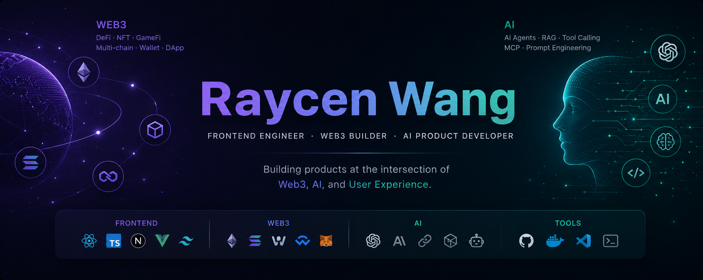

<p align="center">
  
</p>

<h1 align="center">Hi 👋, I'm Raycen Wang</h1>

<h3 align="center">
Frontend Engineer · Web3 Builder · AI Product Developer
</h3>

<p align="center">
Building products at the intersection of Web3, AI, and User Experience.
</p>

---

## 🚀 About Me

拥有 7+ 年前端开发经验，长期专注于 React、TypeScript 生态，并深度参与 DeFi、NFT、GameFi、钱包基础设施等 Web3 项目的架构设计与核心业务开发。

近年来持续探索 AI 应用开发方向，重点关注：

* Prompt Engineering
* RAG（Retrieval-Augmented Generation）
* Tool Calling
* MCP（Model Context Protocol）
* AI Agent
* Workflow Automation

希望将 AI 能力与真实业务场景结合，打造真正创造价值的产品。

---

## 🎯 Current Focus

```text
Prompt
   ↓
RAG
   ↓
Tool Calling
   ↓
MCP
   ↓
AI Agent
   ↓
Production Applications
```

---

## 🛠 Tech Stack

### Frontend

[](https://skillicons.dev)

### Backend & Infrastructure

[](https://skillicons.dev)

### Development Tools

[](https://skillicons.dev)

---

## 🔗 Web3 Stack


---

## 🤖 AI Stack


---

## 💼 Professional Highlights

### 🔹 Web3 Development

* 主导多个 DeFi、NFT、GameFi 项目前端架构设计与核心业务开发
* 完成 MetaMask、WalletConnect、Ledger 等主流钱包接入
* 支持 EVM 多链生态与 Solana 生态
* 设计统一钱包与交易抽象层
* 实现链上交易签名、广播、状态同步与异常处理
* 开发借贷、质押、NFT 市场、资产管理等核心业务模块

### 🔹 Frontend Engineering

* React / TypeScript 深度实践
* 复杂业务系统架构设计与开发
* 组件化体系建设
* 工程化规范建设
* CI/CD 自动化部署
* 性能优化与用户体验提升
* 独立完成需求分析、方案设计与项目交付

### 🔹 AI Applications

* 基于 OpenAI、Claude 构建 AI 工具与工作流
* 实践 Prompt → RAG → Tool Calling → Agent 全链路开发
* 利用 Cursor、Claude Code 提升研发效率
* 探索 AI 在研发、产品与自动化场景中的落地应用

---

## 🚀 Featured Projects

### 🌙 夜里有话

AI 情绪记录与陪伴小程序

**Features**

* AI 树洞对话
* 情绪记录
* 情绪日记
* 成长回顾
* AI 陪伴

**Tech Stack**

TypeScript · 微信小程序 · Supabase · OpenRouter

---

### 🔐 Wallet Integration Framework

统一钱包接入解决方案

**Support**

* MetaMask
* WalletConnect
* RainbowKit
* Multi-chain Support

**Tech Stack**

React · Wagmi · RainbowKit · Viem

---

### 📊 DeFi Dashboard

链上资产与交易数据监控平台

**Tech Stack**

React · TypeScript · TanStack Query · WebSocket · Ethers.js

---

### 🤖 AI Agent Workflow

AI Agent 自动化工作流

**Modules**

* Prompt Engineering
* RAG
* Tool Calling
* Memory
* Agent Orchestration

---

## 📈 GitHub Stats


---

## 📚 Interests

* AI Agents
* AI Product Development
* Web3 Infrastructure
* Frontend Architecture
* Developer Productivity
* Workflow Automation

---

## 📫 Contact

📧 Email

[samx01859@gmail.com](mailto:samx01859@gmail.com)

💻 GitHub

https://github.com/Ross01859

---

<p align="center">
  <b>Building products that connect Web3, AI, and real-world value.</b>
</p>

